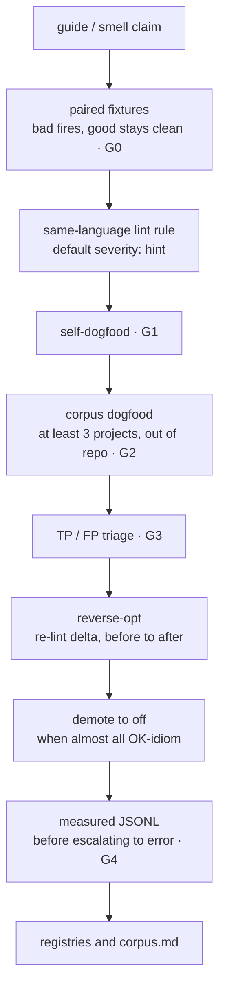

# AGENT.md — XPerf agent operating contract

**Audience:** coding agents (and humans driving them) working on this monorepo.
**Human product docs** stay in [README.md](README.md). **Do not** treat README’s short loop as complete — this file is authoritative for *how work must be done*.

Timezone for notes: **Asia/Shanghai**. Corpora live **outside** the repository (one local directory per kit) — **never** in git, tarballs, or release archives.

---

## Hard gates (do not skip)

A kit change is **not done** until every applicable gate below is green. Skipping a gate is a process bug, not a time-saver.

| Gate | Required for | Done means |
|------|----------------|------------|
| **G0 paired fixtures** | any new/changed rule | `fixtures/bad` fires; `fixtures/good` clean; smoke asserts both |
| **G1 self-dogfood** | any lint change | checker sources + `examples/` clean under `--strict-hints` (and default preset) |
| **G2 corpus ≥3** | scaffold→ready, or rule shape change | ≥3 large real trees pinned in `docs/corpus.md` (URL+commit); dumps under `_lint-runs/` |
| **G3 TP/FP triage** | after every corpus (re)run | sample + classify residuals; write triage note; land reverse-opts; **re-lint** |
| **G4 evidence** | escalate rule to default `error` | `evidence/<RULE>.md` + measured `evidence/<RULE>.jsonl` — never invent ratios |
| **Measured-no-evidence** | after a bench shows reverse / null / no scoped ≥~2× win | **Delete matcher** (tombstone under `evidence/_removed/`); do **not** leave zombie `off`. Unmeasured rules may stay hint/off. |
| **G5 sync-check** | umbrella / packaging | `bash scripts/sync-check.sh` OK |
| **G6 privacy** | **every** change (docs, scripts, examples, evidence, commit messages) | `bash scripts/privacy-check.sh --history` exits 0 — see [Privacy](#privacy-and-publication-hygiene) |
| **G7 docs** | any Markdown or guide change | `bash scripts/doc-check.sh` and `bash scripts/build-guides.sh --check` exit 0; edit `guide-src`, never the generated guide — see [docs/doc-style.md](docs/doc-style.md) |

**G3 is mandatory.** Corpus raw counts and path-skip-only reverse-opt **do not** satisfy G3. Findings after path skips are still untrusted until triaged.

### What “corpus-ready” means

A kit may be called **corpus-ready** only if **all** hold after G3:

1. TRIAGE note exists with labels (TP/FP/OK-idiom/DOC/SKIP-path) and before→after counts.
2. Sample FP+DOC+SKIP-path share is **≤ ~40%** after reverse-opt.
3. At least some residuals are honest **TP** (not “everything is OK-idiom”).
4. No default `error` without G4.

If (2) or (3) fails: say **not corpus-ready**, keep hint/`off`, do not claim usefulness. Scaffold + G3-complete ≠ corpus-ready.

---

## Privacy and publication hygiene

This repository is public: every tracked file, commit message and author field is published. **G6 is enforced by `scripts/privacy-check.sh` (also in CI); only a passing run counts.**

**Never commit:**

1. Non-public company, product, customer or host names. The list is **not** in this repo (it would leak them); it lives in each maintainer's local denylist (`$XPERF_PRIVACY_DENYLIST`, default `~/.config/xperf/privacy-denylist`). Add new names there first.
2. Private network identifiers: overlay-VPN / carrier-NAT addresses and DNS names, RFC1918 addresses, internal hostnames.
3. Maintainer-machine paths, usernames, or defaults that are absolute paths. Derive paths from the script location or a git-ignored in-repo directory; allow an env override.
4. References to files outside the repo (research notes, triage notes, lint dumps, corpora) and narration about the dev machine. Say "corpora are not distributed; clone locally".
5. Credentials, even in examples. Machine-specific data (hostname, CPU model string) stays out of evidence files; write "x86-64 Linux, 8 cores".

**Before every commit:** run `bash scripts/privacy-check.sh --history`, fix hits at the source (reword; never weaken the check), and read the diff for what a regex cannot see (real names, pasted logs, internal URLs).

**If something leaks:** stop and tell the maintainer. A follow-up commit does not remove it from history; rewriting history needs explicit approval, and leaked credentials must be revoked. Then add the missing pattern to the script or denylist, with a negative test.

---

## Rule IDs (semantic slugs)

Canonical finding ids are **semantic slugs only**: `{family}-{smell}` in kebab-case, e.g. `at-includes-hot`, `gp-append-nil-slice`, `zp-alloc-hot`.

| Rule | Detail |
|------|--------|
| Charset | `[a-z][a-z0-9-]*`, max ~40 chars, no leading/trailing hyphen, no `--` |
| Stability | Slugs are **forever**. Removed smells get a tombstone under `evidence/_removed/` (and/or `docs/rule-ids.md`); **never reuse** a slug |
| Scope default | Kits that support `--scope` / kit-equivalent default to **`all`** (report outside loops/hot paths too). Opt in to **`--scope loop`** for the former loop-only match. Finding text must not imply “only fix in a loop.” |
| Renames (`*-in-loop` → `*-hot`) | Renamed slugs are tombstoned forever under `evidence/_removed/*.REMOVED.md` and listed in each kit `docs/rule-ids.md` Renamed table; **never reuse** the old slug |
| Numerics | **Gone.** Old codes (`AT004`, `GP001`, `ZP001`, …) are **not** accepted in `--severity`, suppressions, fixtures, or emitted `rule` fields. No alias layer. |
| New rules | Slug only — do **not** allocate `XX000` numbers |
| Maps | [docs/rule-id-map.md](docs/rule-id-map.md) and `scripts/rule-id-map.json` are a **historical** one-time migration reference (inactive). Per-kit `docs/rule-ids.md` lists active slugs. |
| Removals (2026-10-22 jitter) | Tombstones only, never got slugs: `CX001`, `CX003`, `CX004`, `BE002`, `KT004`, `OC001`, `OC004`, `PP004` |
| Removals (2026-10-22 no-evidence gate) | Measured-useless → tombstone+delete matcher: `jp-legacy-synchronized-type`, `jp-many-boolean-fields` (slugs never reused) |

G0 smoke must assert **slug** ids. G4 evidence files are named by slug (`evidence/<slug>.jsonl`).

## Closed loop (authoritative)

Residual corpus counts are **review prompts**, never speed claims. Heuristic fire ≠ useful.

Supporting human docs: [docs/playbook.md](docs/playbook.md), [docs/overview.md](docs/overview.md), [docs/rule-regression.md](docs/rule-regression.md).

---

## G3 — TP/FP triage (how)

### Sample size

Per corpus tree, after path-skip baseline (or latest rN dump):

- If findings **≤ 40**: classify **all**.
- If findings **> 40**: classify a **stratified sample of ≥ 40**, covering every fired rule id at least twice when possible.
- When **20% of findings > 80**, you may cap at **~80** stratified (still ≥2 per rule) — full 20% is optional, not mandatory. Record the cap in TRIAGE.
- Prefer hot paths / library core over tests (tests should already be skipped; if not, fix skips first then resample).

### Labels (required)

| Label | Meaning |
|-------|---------|
| **TP** | Real smell; fixing would plausibly help a hot or alloc-sensitive path |
| **FP** | Checker wrong (not in loop, already reserved/capacity, wrong API, macro/doc, etc.) |
| **OK-idiom** | Matches pattern but is intentional / cold / framework-correct — keep hint or suppress shape |
| **DOC** | Doctest / `@doc` example / comment / string — must not fire |
| **SKIP-path** | Should have been excluded by path policy |

Record: `path:line`, rule id, label, one-line reason. Keep the full triage note next to the corpus (outside the repo) and summarize in `packages/<kit>/docs/corpus.md` (FP themes + fixes landed).

### After triage

1. Land reverse-opts that kill **FP** / **DOC** / systematic **OK-idiom** noise (path skips, AST/heuristic tighten, allowlists).
2. Add **good** fixtures for every FP class you fixed.
3. Re-run smoke + self-lint + corpus; publish before→after table.
4. Leave true **TP** residuals as hint until **G4** evidence exists — do not mass-escalate.
5. If a rule’s sample is **almost all OK-idiom** on mature libraries: **demote default to `off`** (or narrow the pattern) and document why — required G3 outcome, not optional polish.

### Stop / escalate

- If FP+DOC+SKIP-path share of the sample is **> ~40%**, do **not** call the kit “corpus-ready”; keep reverse-opting.
- If almost-all OK-idiom after reverse-opt: demote/`off` — do not pretend usefulness.
- **corpus-ready** definition: see box under Hard gates.

---

## New kit checklist

1. Scaffold under `packages/<name>/` (same layout as siblings): lint in **same language**, **kit-local** rule ids (`nm-seq-add-hot`, `gp-make-hot`, … — not a shared global namespace), README, evidence stubs (md only; **no** fake JSONL), paired fixtures, `scripts/smoke-lint.sh` + `self-lint.sh`.
2. **Wire umbrella (all of these):**
   - root [README.md](README.md) package table row
   - `scripts/sync-check.sh` — both the `case` arm **and** the scaffold `for p in …` list
   - `.github/workflows/ci.yml` smoke job (`continue-on-error: true` OK if toolchain is exotic)
   - `.github/pull_request_template.md` checkbox
   - [docs/smell-catalog.md](docs/smell-catalog.md) kit row + smell matrix stub
   - [docs/rule-regression.md](docs/rule-regression.md) rule table
   - [CHANGELOG.md](CHANGELOG.md) `[Unreleased]` / Unreleased bullet
3. Run **G0–G3** on ≥3 corpora before claiming dogfood done. G4 only when escalating.
4. Never include research corpora in archives or syncs of the packages.

### Choosing corpora (G2)

- Prefer **well-known production** trees (language stdlib/compiler, popular frameworks, large apps).
- Niche languages: compiler/stdlib + **two** widely used libraries is acceptable if each has substantial `.ext` sources (aim **hundreds of files** or a clearly “large” project — do not invent tiny toy repos to hit “3”).
- Pin **URL + commit** (or shallow `rev-parse --short`) and size in `docs/corpus.md`.
- Shallow clones (`git clone --depth 1`) are fine.

---

## Missing toolchain / G1 self-hits

1. **Same-language lint remains the ship target.** If this machine lacks the compiler/SDK, do **not** skip G0–G3:
   - Keep paired fixtures + smoke that assert bad fires / good clean.
   - A **documented heuristic-parity fallback** (language-appropriate: e.g. `scripts/text-lint.cjs`, a Python mirror, etc.) may run corpus G2/G3 and fixture smoke. Say so in `docs/corpus.md` and TRIAGE.
   - Re-run smoke/self-lint with the real toolchain when available; do not claim binary/SDK-verified without that.
2. **G1 self-dogfood:** checker sources must stay clean under `--strict-hints`.
   - Prefer **rewriting** call sites (`setLen` / index writes / `stdout.writeLine` instead of `echo` / `print` in loops) over weakening rules.
   - **Do not** put the rule’s match tokens (e.g. the substring `.add(`) inside a `for`/`while` body in the checker source — that is a self-hit, not a corpus FP class.
   - Tightening the rule (numeric `+=`, API allowlists) + **good** fixtures is OK; do not weaken smoke.
3. Languages where one method name serves many types (e.g. Nim `add` on `seq` **and** `string`, or macro `NimNode.add`) need **language-specific suppressions** after G3 — document in TRIAGE.
4. **corpus-ready** still requires the definition under Hard gates.

---

## What README keeps vs this file

| Topic | Where |
|-------|--------|
| Package table, license, how to run linters | [README.md](README.md) |
| Agent closed loop, G0–G7, TP/FP protocol, privacy rules | **this file** |
| Human operating narrative | [docs/playbook.md](docs/playbook.md) (points here for gates) |

When README and AGENT.md disagree on process, **AGENT.md wins**.

---

## Honesty rules

- Never invent bench numbers or JSONL ratios.
- Never commit corpus clones, lint dumps or triage notes; they stay outside the repository.
- Never claim G6 from reading files; only a passing `scripts/privacy-check.sh --history` counts.
- Say **pending** when evidence is missing.
- Fixture pass ≠ wall-clock claim.
- `OSS_READY` / “useful on real code” / **corpus-ready** requires G3 triage notes meeting the definition above.
