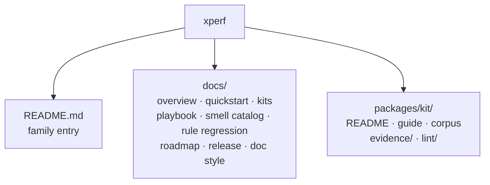

# XPerf docs

Shared documentation for the **XPerf** umbrella (multi-kit family). Per-language guides and lint docs live under each package.

GitHub Pages renders this directory and the per-kit guides. Preview with `bash scripts/build-pages.sh serve`. See [release.md](release.md).

## Shared (this directory)

| Doc | Purpose |
|-----|---------|
| [branding.md](branding.md) | Display name **XPerf** vs paths `xperf` |
| [doc-style.md](doc-style.md) | Markdown conventions enforced by `scripts/doc-check.sh` |
| [release.md](release.md) | What we publish on `v*` tags |
| [overview.md](overview.md) | What XPerf is: kit architecture, shared loop, evidence rule |
| [playbook.md](playbook.md) | Operating loop: inventory → evidence → corpus → reverse-opt → dogfood → docs |
| [kits.md](kits.md) | Lint entry points, defaults, corpus-ready notes (slug-only) |
| [quickstart.md](quickstart.md) | Per-language build/run commands |
| [smell-catalog.md](smell-catalog.md) | Cross-language smell index (IDs are per-kit slugs) |
| [rule-regression.md](rule-regression.md) | Positive/negative fixtures + evidence coverage; honest gaps |
| [rule-id-map.md](rule-id-map.md) | Historical numeric → slug map (CLI does not accept numerics) |
| [roadmap-next.md](roadmap-next.md) | Next work under the same method |
| [static-check-sources.md](static-check-sources.md) | Forum, blog, and GitHub sources for shapes a linter can see |

## Per-package entry points

| Kit | Guide | Corpus / evidence policy | Lint docs |
|-----|-------|--------------------------|-----------|
| **zperf** | [zig-performance-guide.md](../packages/zperf/docs/zig-performance-guide.md) | [evidence-policy.md](../packages/zperf/docs/evidence-policy.md) · `packages/zperf/evidence/` | [zperf-lint/README](../packages/zperf/zperf-lint/README.md) |
| **cperf** | [c-performance-guide.md](../packages/cperf/docs/c-performance-guide.md) | [corpus.md](../packages/cperf/docs/corpus.md) · [evidence-policy.md](../packages/cperf/docs/evidence-policy.md) | `packages/cperf/cperf-lint/` |
| **jsperf** | [js-performance-guide.md](../packages/jsperf/docs/js-performance-guide.md) | [corpus.md](../packages/jsperf/docs/corpus.md) · [evidence-policy.md](../packages/jsperf/docs/evidence-policy.md) | `packages/jsperf/jsperf-lint/` |
| **jvmperf** | [en/](../packages/jvmperf/docs/en/) | [corpus.md](../packages/jvmperf/docs/corpus.md) · [evidence-policy.md](../packages/jvmperf/docs/evidence-policy.md) | `packages/jvmperf/jvmperf-lint/` |
| **goperf** | [go-performance-guide.md](../packages/goperf/docs/go-performance-guide.md) | [corpus.md](../packages/goperf/docs/corpus.md) · [evidence-policy.md](../packages/goperf/docs/evidence-policy.md) | `packages/goperf/goperf-lint/` |
| **pyperf** | [python-performance-guide.md](../packages/pyperf/docs/python-performance-guide.md) | [corpus.md](../packages/pyperf/docs/corpus.md) · [evidence-policy.md](../packages/pyperf/docs/evidence-policy.md) | `packages/pyperf/pyperf-lint/` |
| **swiftperf** | [swift-performance-guide.md](../packages/swiftperf/docs/swift-performance-guide.md) | [corpus.md](../packages/swiftperf/docs/corpus.md) · [evidence-policy.md](../packages/swiftperf/docs/evidence-policy.md) | `packages/swiftperf/swiftperf-lint/` |
| **arktsperf** | [arkts-performance-guide.md](../packages/arktsperf/docs/arkts-performance-guide.md) | [corpus.md](../packages/arktsperf/docs/corpus.md) · [evidence-policy.md](../packages/arktsperf/docs/evidence-policy.md) | `packages/arktsperf/arktsperf-lint/` |
| **cppperf** | [cpp-performance-guide.md](../packages/cppperf/docs/cpp-performance-guide.md) | [corpus.md](../packages/cppperf/docs/corpus.md) · [evidence-policy.md](../packages/cppperf/docs/evidence-policy.md) | `packages/cppperf/cppperf-lint/` |
| **csharpperf** | [csharp-performance-guide.md](../packages/csharpperf/docs/csharp-performance-guide.md) | [corpus.md](../packages/csharpperf/docs/corpus.md) · [evidence-policy.md](../packages/csharpperf/docs/evidence-policy.md) | `packages/csharpperf/csharpperf-lint/` |
| **phpperf** | [php-performance-guide.md](../packages/phpperf/docs/php-performance-guide.md) | [corpus.md](../packages/phpperf/docs/corpus.md) · [evidence-policy.md](../packages/phpperf/docs/evidence-policy.md) | `packages/phpperf/phpperf-lint/` |
| **rubyperf** | [ruby-performance-guide.md](../packages/rubyperf/docs/ruby-performance-guide.md) | [corpus.md](../packages/rubyperf/docs/corpus.md) · [evidence-policy.md](../packages/rubyperf/docs/evidence-policy.md) | `packages/rubyperf/rubyperf-lint/` |
| **rustperf** | [rust-performance-guide.md](../packages/rustperf/docs/rust-performance-guide.md) | [corpus.md](../packages/rustperf/docs/corpus.md) · [evidence-policy.md](../packages/rustperf/docs/evidence-policy.md) | `packages/rustperf/rustperf-lint/` |
| **kotlinperf** | [kotlin-performance-guide.md](../packages/kotlinperf/docs/kotlin-performance-guide.md) | [corpus.md](../packages/kotlinperf/docs/corpus.md) · [evidence-policy.md](../packages/kotlinperf/docs/evidence-policy.md) | `packages/kotlinperf/kotlinperf-lint/` |
| **objcperf** | [objc-performance-guide.md](../packages/objcperf/docs/objc-performance-guide.md) | [corpus.md](../packages/objcperf/docs/corpus.md) · [evidence-policy.md](../packages/objcperf/docs/evidence-policy.md) | `packages/objcperf/objcperf-lint/` |
| **dartperf** | [dart-performance-guide.md](../packages/dartperf/docs/dart-performance-guide.md) | [corpus.md](../packages/dartperf/docs/corpus.md) · [evidence-policy.md](../packages/dartperf/docs/evidence-policy.md) | `packages/dartperf/dartperf-lint/` |
| **luaperf** | [lua-performance-guide.md](../packages/luaperf/docs/lua-performance-guide.md) | [corpus.md](../packages/luaperf/docs/corpus.md) · [evidence-policy.md](../packages/luaperf/docs/evidence-policy.md) | `packages/luaperf/luaperf-lint/` |
| **beamperf** | [beam-performance-guide.md](../packages/beamperf/docs/beam-performance-guide.md) | [corpus.md](../packages/beamperf/docs/corpus.md) · [evidence-policy.md](../packages/beamperf/docs/evidence-policy.md) | `packages/beamperf/beamperf-lint/` |
| **nimperf** | [nim-performance-guide.md](../packages/nimperf/docs/nim-performance-guide.md) | [corpus.md](../packages/nimperf/docs/corpus.md) · [evidence-policy.md](../packages/nimperf/docs/evidence-policy.md) | `packages/nimperf/nimperf-lint/` |

## Navigation sketch

