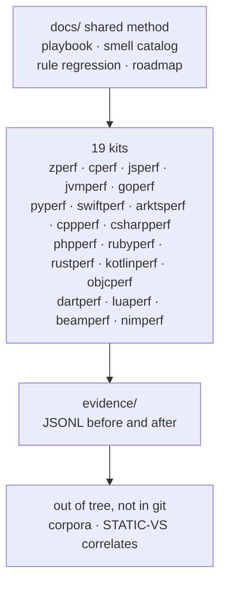

# XPerf overview

**XPerf** is the umbrella for language performance kits. Each kit is independently usable: a measured guide, examples, fixtures, and a heuristic linter written in (or for) that language. The root holds shared method docs and the cross-kit smell index — not a Zig-only tree with other languages bolted on.

## Architecture

**Shared loop** (see [playbook.md](playbook.md)): inventory → evidence → corpus lint → reverse-opt → dogfood → docs. Severity escalates to default `error` only with paired fixtures **and** measured before/after JSONL.

**Cross-lang index:** [smell-catalog.md](smell-catalog.md) maps the same *smell* across kits. Rule IDs are **per-kit** slugs; jsperf and jvmperf both use the `jp-` prefix with disjoint slug sets (jsperf `jp-alloc-in-loop` ≠ any jvmperf rule). A YES on one runtime does not transfer — re-bench when porting advice.

## Per-kit status

**All 19 kits passed the AGENT.md corpus-ready (G3) gate** as of 2026-10-22 (Asia/Shanghai). Heuristics ≠ guaranteed speedups.

| Kit | Lint entry | Guide | Notes |
|-----|------------|-------|-------|
| **zperf** | `zperf-lint` (Zig AST) | EN · **corpus-ready** | G3/r4; default-on TP set; OK-idiom mass off; allocPrint-in-loop hint |
| **cperf** | `cperf-lint` (C11) | EN v0 · **corpus-ready** | cp-alloc / cp-realloc error; strlen, hot-call, wide-bool-flag, alloca-in-loop, and large by-value struct hints; cp-printf / cp-strcat off |
| **jsperf** | `jsperf-lint` (pure JS) | EN v0 + V8/startup · **corpus-ready** | jp-delete-array-hole error; string+/map-filter/regex/JSON/DOM/readFile/clock hint; alloc/delete-shape off |
| **jvmperf** | `jvmperf-lint` (Java) | EN · **corpus-ready** | G3/G4 defaults; JMH/JOL; STATIC-VS-HOTSPOT |
| **goperf** | `goperf-lint` (Go) | EN v0 · **corpus-ready** | append-nil / defer / regexp / JSON / reflect / open / clock hint; make/string+/fmt off |
| **pyperf** | `pyperf-lint` (pure Python) | EN v0 · **corpus-ready** | list-plus plus JSON/deepcopy/open hint; str+/print off; re.compile and datetime-format removed |
| **swiftperf** | `swiftperf-lint` (Swift PM) | EN v0 · **corpus-ready** | reserve / map-joined hint, plus date-formatter / JSON / regex / file-read / clock / value-for-key hints; text-lint parity without SDK |
| **arktsperf** | `arktsperf-lint` (pure Node) | EN v0 · **corpus-ready** | at-includes / at-json hint; alloc/delete/console off |
| **cppperf** | `cppperf-lint` (C++17) | EN v0 · **corpus-ready** | regex, endl, clock, ifstream, const-by-value, and vector-bool hints (string append and string-stream removed); ≠ cperf |
| **csharpperf** | `csharpperf-lint` (dotnet) | EN v0 · **corpus-ready** | regex / LINQ materialize / format / JSON / file-read / clock / field-by-name hint; list/string+/console off; needs `dotnet` |
| **phpperf** | `phpperf-lint` (pure PHP) | EN v0 · **corpus-ready** | ph-array-merge-rebind error (G4); ph-string-dot-in-loop off; ph-echo-in-loop hint |
| **rubyperf** | `rubyperf-lint` (pure Ruby) | EN v0 · **corpus-ready** | hash-merge / regexp / JSON / file-read hint; string+/array+/puts off |
| **rustperf** | `rustperf-lint` (Rust) | EN v0 · **corpus-ready** | format-rebind error; string+/println/vec/collect/regex/file-open/clock hint; alloc off |
| **kotlinperf** | `kotlinperf-lint` (Kotlin) | EN v0 · **corpus-ready** | kt-* all off by default; empty-add rule removed; ≠ jvmperf JMH |
| **objcperf** | `objcperf-lint` (C scan .m) | EN v0 · **corpus-ready** | append / nslog off; date-formatter, JSON, regex, file-read, clock, and value-for-key hints; array-add rules removed; ≠ swiftperf |
| **dartperf** | `dartperf-lint` (Dart) | EN v0 · **corpus-ready** | dt-growable-add-empty hint; list/string+/print off |
| **luaperf** | `luaperf-lint` (pure Lua) | EN v0 · **corpus-ready** | lu-string-concat-in-loop error (G4); lu-table-insert-in-loop off; lu-print-in-loop hint |
| **beamperf** | `beamperf-lint` (Elixir) | EN v0 · **corpus-ready** | be-list-concat / be-map-merge / be-enum-chain hint; string-<> removed; be-io-puts off |
| **nimperf** | `nimperf-lint` (Nim) | EN v0 · **corpus-ready** | nm-seq-no-capacity hint; seq-add/string/echo off; needs `nim` |

## What this is not

- Not a substitute for `perf`, Tracy, JMH, or browser profilers.
- Not type-aware analysis (except where a language toolchain already embeds it).
- Not a place for large third-party source trees (those stay outside the repo).

## Evidence rule

Guide claims that assert speedups should name a local JSONL bench, an upstream issue/PR, or both. Heuristic lint findings and corpus residual counts are review prompts / dogfood, **not** speedups. Coverage and honest gaps: [rule-regression.md](rule-regression.md).

## Docs

- [README.md](README.md) — this folder’s index
- [playbook.md](playbook.md) — shared loop + rule regression contract
- [kits.md](kits.md) — per-kit default severities
- [quickstart.md](quickstart.md) — build/run commands per language
- [release.md](release.md) — what a `v*` tag publishes
- [rule-id-map.md](rule-id-map.md) — historical numeric → slug map
- [smell-catalog.md](smell-catalog.md) — cross-kit smells
- [rule-regression.md](rule-regression.md) — fixture + evidence matrix
- [roadmap-next.md](roadmap-next.md) — next loops
