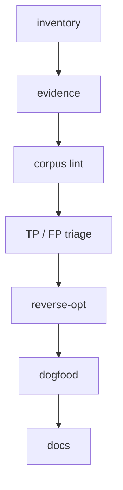

# XPerf playbook

Operating method for the **XPerf** family. Same loop per kit; evidence and corpora stay kit-local.

**Agents:** follow root [AGENT.md](../AGENT.md) gates **G0–G7**. This playbook is the human narrative; if it disagrees with AGENT.md on process, **AGENT.md wins**. Especially: corpus without **TP/FP triage (G3)** is incomplete.

## Loop

1. **Inventory** — list guide chapters, missing evidence, lint rule coverage.
2. **Evidence** — JSONL (or language-native) microbenches under `-O2` / ReleaseFast / equivalent; record machine and flags. Required before default `error` (AGENT **G4**).
3. **Corpus lint** — shallow-clone ≥3 real projects; run the checker (AGENT **G2**).
4. **TP/FP triage** — sample residuals; label TP / FP / OK-idiom / DOC / SKIP-path; write `TRIAGE-*.md` (AGENT **G3** — **mandatory**, not optional).
5. **Reverse-opt** — tighten rules, skip paths, add good fixtures for FP classes; re-run corpus deltas.
6. **Dogfood** — checker + examples clean; bad fixtures intentional (AGENT **G0/G1**).
7. **Docs** — dry tone pass; update `corpus.md` + registries.

## Corpus loop (packages)

Corpora named per kit (first dogfood round 2026-10-21 Asia/Shanghai; later rounds in each kit's `docs/corpus.md`). Clones stay outside the repo; packages only keep `docs/corpus.md` and guide citations.

| Package | Lint | Corpora dogfooded (r1–r3) | Guide chapters tied to findings |
|---------|------|---------------------------|----------------------------------|
| **cperf** | `cperf-lint` cp-alloc-in-loop–cp-strcat-in-loop | quickjs, lua, gcc (sparse), sqlite `src/` | `01_allocation` (cp-alloc-in-loop, cp-realloc-grow-one), `02_hot_io` (cp-printf-in-loop dump/codegen) |
| **jsperf** | `jsperf-lint` jp-alloc-in-loop–jp-map-filter-chain | Node `lib/`, Preact `src/`, quickjs `*.js`, TypeScript `packages/typescript/src` + V8 benches | `01`…`03`, **`04_v8_optimizations`** (lint≠JIT; `STATIC-VS-V8.md`) |
| **zperf** | `zperf-lint` | zig std + selected apps (see zperf docs) | full EN |
| **jvmperf** | `jvmperf-lint` 29 active rules, slugs in `packages/jvmperf/docs/rule-ids.md` | okhttp, retrofit, kotlinx.coroutines, guava `src`, vert.x, fastjson2, jetty-core, netty buffer+common | EN with JMH/JOL Evidence; `packages/jvmperf/docs/corpus.md` |

Re-run: path/dir skips → rule suppressions → before/after tables in the kit's `docs/corpus.md`. Do not treat residual counts as wall-time claims.

## Deliverables per kit

- Guide with chapter stubs → measured claims over time
- Lint with `--format text|json`, `--preset app|engine|all`, `--severity RULE=error|hint|off`; exit non-zero only on **error** findings (optional `--strict-hints`, `--no-fail`)
- `fixtures/good` / `fixtures/bad` for 2–3 starter rules
- Research notes outside git

## Severity and presets (cperf / jsperf 0.3.x)

Default **`app`**: keep rules that correlate with measured pain as `error` (C: cp-alloc-in-loop and cp-realloc-grow-one; JS: jp-delete-array-hole); demote noisy corpus-heavy rules to `hint` or `off` (C: cp-printf-in-loop and cp-strcat-in-loop off; JS: jp-alloc-in-loop, jp-console-in-loop and jp-delete-shape off, jp-map-filter-chain hint). JS `jp-string-plus-in-loop` was removed after `push` + `join` missed ~2×. **`engine`** keeps the same idea with a few more hints for engine trees. **`all`** restores “every finding fails” (pre-0.3 behavior). Hints still print; they do not fail CI unless `--strict-hints`. Prefer evidence gates over residual counts.

## What else

See [roadmap-next.md](roadmap-next.md) — next loops under the same method (evidence gates, severity, dynamic companions, own corpora).

## Cross-kit smells

See [smell-catalog.md](smell-catalog.md) — alloc-in-loop / layout / hot-IO / holey / delete mapped across zperf / cperf / jsperf / jvmperf, plus the newer kits (IDs per-kit).

Evidence correlates: jsperf `STATIC-VS-V8`, cperf `STATIC-VS-O2` (kept outside the repo).

## Rule regression

Paired positive/negative cases exist so we can later ask: does this rule still **mean something** (still correlates with speed) and still **fire** (still effective after compiler/runtime upgrades)?

Two layers:

1. **Lint fixtures** — under each package’s `*-lint/fixtures/`:
   - `bad/` must produce the rule (positive: the smell still matches).
   - `good/` must stay clean (negative: legal / hoisted / suppressed shapes do not false-fire).
   - Re-run `make check` / `npm test` / `gradlew test` on toolchain bumps (Zig, cc, Node, JDK). Fixture pass ≠ wall-clock claim.

2. **Evidence (speed gate)** — under `packages/*/evidence/`:
   - Keep or escalate a rule to default **`error`** only with `<RULE>.md` + before/after `<RULE>.jsonl` (each kit keeps its own `docs/evidence-policy.md`, e.g. [cperf](../packages/cperf/docs/evidence-policy.md)).
   - Re-run benches when **Node/V8**, **gcc/clang**, or **JDK** majors move; update medians if ratios shift.
   - Residual corpus counts and deopt/compilation log line counts are **not** speed claims and do not escalate severity.

Cross-kit smell map: [smell-catalog.md](smell-catalog.md). Honest per-rule coverage (fixtures + evidence gaps): [rule-regression.md](rule-regression.md).
