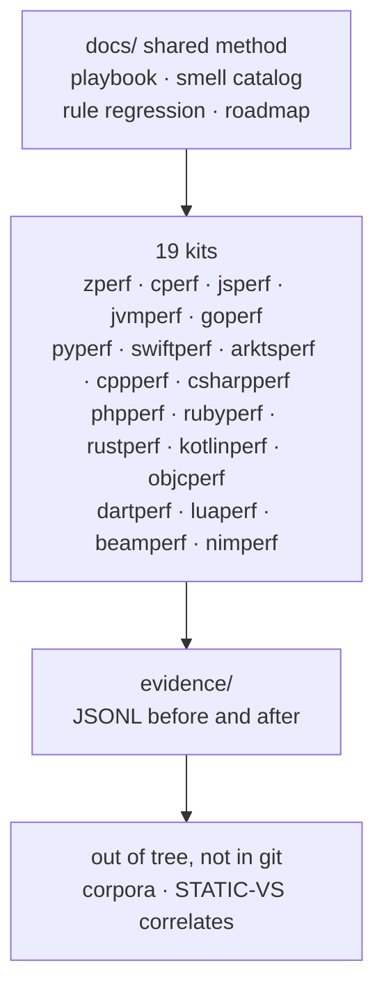

# XPerf 概览

**XPerf** 是各语言性能 kit 的总伞项目。每个 kit 可独立使用：一份有测量依据的指南、示例、fixtures，以及用该语言（或面向该语言）编写的启发式 linter。根目录放共享方法文档与跨 kit 的 smell 索引——不是「以 Zig 为主、其它语言外挂」的树。

## 架构

**共享闭环**（见 [playbook.md](playbook.md)）：盘点 → 证据 → corpus lint → 反向优化 → dogfood → 文档。只有在成对 fixtures **并且** 有测得的 before/after JSONL 时，严重级别才升为默认 `error`。

**跨语言索引：** [smell-catalog.md](smell-catalog.md) 把同一类 *smell* 映射到各 kit。规则 ID 是 **按 kit** 的 slug；jsperf 与 jvmperf 都用 `jp-` 前缀但 slug 集合不相交（jsperf 的 `jp-alloc-hot` ≠ 任何 jvmperf 规则）。某一运行时上的 YES 不能直接搬到另一运行时——移植建议时请重新测。

## 各 kit 状态

截至 2026-10-22（Asia/Shanghai），**全部 19 个 kit 已通过 AGENT.md 的 corpus-ready（G3）门槛**。启发式 ≠ 保证加速。

| Kit | Lint 入口 | 指南 | 备注 |
|-----|------------|------|------|
| **zperf** | `zperf-lint`（Zig AST） | 英文 · **corpus-ready** | G3/r4；默认开启的 TP 集；OK-idiom 大量 off；allocPrint-in-loop 为 hint |
| **cperf** | `cperf-lint`（C11） | 英文 v0 · **corpus-ready** | cp-alloc / cp-realloc 为 error；strlen、热调用、wide-bool-flag、alloca-in-loop、大结构体按值传递为 hint；cp-printf / cp-strcat 为 off |
| **jsperf** | `jsperf-lint`（纯 JS） | 英文 v0 + V8/启动 · **corpus-ready** | jp-delete-array-hole 为 error；string+/map-filter/regex/JSON/DOM/readFile/clock 为 hint；alloc/delete-shape 为 off |
| **jvmperf** | `jvmperf-lint`（Java） | 英文 · **corpus-ready** | G3/G4 默认；JMH/JOL；STATIC-VS-HOTSPOT |
| **goperf** | `goperf-lint`（Go） | 英文 v0 · **corpus-ready** | append-nil / defer / regexp / JSON / reflect / open / clock 为 hint；make/string+/fmt 为 off |
| **pyperf** | `pyperf-lint`（纯 Python） | 英文 v0 · **corpus-ready** | list-plus 以及 JSON/deepcopy/open 为 hint；str+/print 为 off；re.compile 与 datetime-format 已移除 |
| **swiftperf** | `swiftperf-lint`（Swift PM） | 英文 v0 · **corpus-ready** | reserve / map-joined hint，以及 date-formatter / JSON / regex / file-read / clock / value-for-key hint；无 SDK 时 text-lint 对等 |
| **arktsperf** | `arktsperf-lint`（纯 Node） | 英文 v0 · **corpus-ready** | at-includes / at-json 为 hint；alloc/delete/console 为 off |
| **cppperf** | `cppperf-lint`（C++17） | 英文 v0 · **corpus-ready** | regex、endl、clock、ifstream、const-by-value、vector-bool 等 hint |
| **csharpperf** | `csharpperf-lint`（C#） | 英文 v0 · **corpus-ready** | 构建器 / 热 I/O / 热调用 hint |
| **phpperf** | `phpperf-lint`（PHP） | 英文 v0 · **corpus-ready** | 字符串与数组重绑定 / echo hint |
| **rubyperf** | `rubyperf-lint`（Ruby） | 英文 v0 · **corpus-ready** | 构建器 / 热 I/O / 热调用 |
| **rustperf** | `rustperf-lint`（Rust） | 英文 v0 · **corpus-ready** | 分配 / 字符串 / 热调用 |
| **kotlinperf** | `kotlinperf-lint`（Kotlin） | 英文 v0 · **corpus-ready** | ≠ jvmperf JMH；集合与字符串 |
| **objcperf** | `objcperf-lint`（Objective-C） | 英文 v0 · **corpus-ready** | ≠ swiftperf；集合 / 字符串 / formatter |
| **dartperf** | `dartperf-lint`（Dart） | 英文 v0 · **corpus-ready** | list / string |
| **luaperf** | `luaperf-lint`（Lua） | 英文 v0 · **corpus-ready** | table / string |
| **beamperf** | `beamperf-lint`（Elixir/Erlang） | 英文 v0 · **corpus-ready** | list / binary |
| **nimperf** | `nimperf-lint`（Nim） | 英文 v0 · **corpus-ready** | seq / string / I/O |

命令与默认值见 [kits.md](kits.md)；历史数字 ID → slug 见 [rule-id-map.md](rule-id-map.md)。
